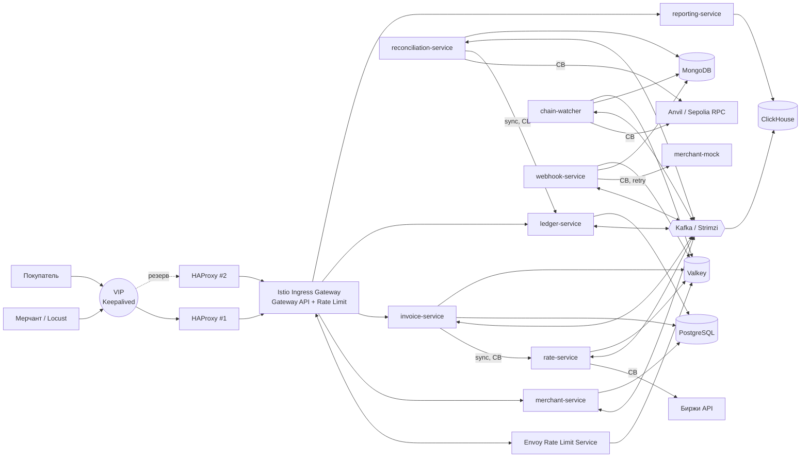
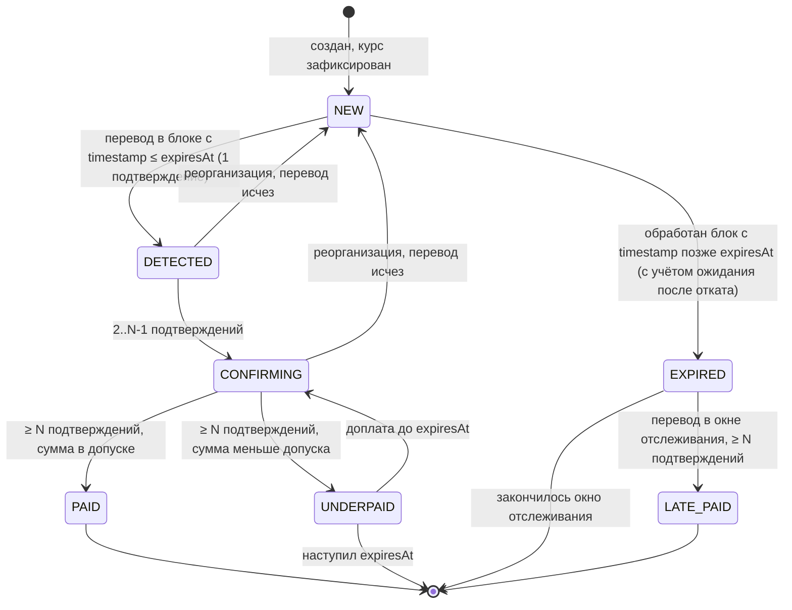
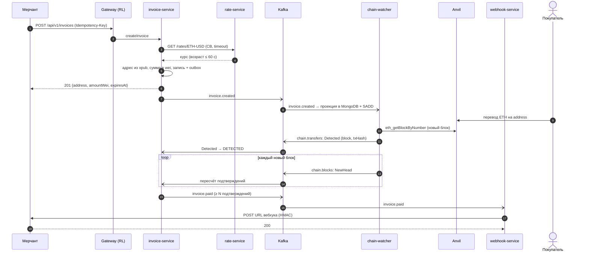

# Техническое задание на создание шлюза криптоплатежей «Weigate»

## 1. Общие сведения

1.1. **Наименование:** шлюз приёма криптоплатежей «Weigate» (далее — Система).

1.2. **Режим работы:** локальный стенд в кластере Kubernetes. Работа идёт только с тестовыми сетями: локальной Anvil и, опционально, Sepolia. **Основная сеть Ethereum и реальные средства не используются.**

---

## 2. Назначение

Система позволяет интернет-магазину (мерчанту) принимать оплату в криптовалюте:

1. Магазин выставляет счёт в долларах.
2. Система фиксирует курс, выдаёт покупателю уникальный адрес и сумму в ETH.
3. Система следит за блокчейном и дожидается нужного числа подтверждений.
4. Магазин получает подписанный вебхук о результате оплаты.

---

## 3. Характеристика объекта автоматизации

3.1. **Предметная область.** Счёт (invoice) живёт ограниченное время (15 минут), за которое покупатель должен перевести точную сумму на выданный адрес. Транзакция считается окончательной после N подтверждений (N = 7 на Anvil: больше поддерживаемой глубины реорганизации, поэтому статус, полученный после N подтверждений, реорганизация не отменяет). В блокчейне возможна **реорганизация цепочки**: уже увиденные блоки и транзакции отменяются, и Система обязана это корректно обработать.

3.2. **Роли.**

| Роль | Описание |
|---|---|
| Мерчант | Создаёт счета через API, получает вебхуки, смотрит статусы |
| Покупатель | Видит страницу оплаты (адрес, сумма, таймер, статус), отправляет перевод |
| Оператор платформы | Разворачивает, наблюдает, реагирует на алерты |
| Блокчейн-нода (внешняя) | Anvil в кластере (основной вариант) или RPC Sepolia |
| Биржи (внешние) | Публичные API котировок: Coinbase, OKX |

3.3. **Границы Системы.** Система **некастодиальная по ключам**: в ней хранится только расширенный публичный ключ мерчанта (xpub), из которого выводятся адреса (BIP-32/44). Приватные ключи в Систему не попадают. **Вне рамок:** вывод средств (sweeping), фиатные расчёты, KYC/AML, сети кроме EVM-совместимых.

---

## 4. Требования к Системе

### 4.1. Архитектура

4.1.1. Внешний трафик проходит цепочку **Keepalived (VIP) → HAProxy (L4) → Istio Ingress Gateway (L7, Gateway API, rate limiting) → сервисы**.

4.1.2. Межсервисное взаимодействие **асинхронное, через Kafka**. Синхронных внутренних вызовов три; первые два защищены Circuit Breaker:
- `invoice-service → rate-service` — фиксация курса при создании счёта; без курса счёт выставить нельзя;
- `reconciliation-service → ledger-service` (API выписок) — сверка проверяет фактическое содержимое леджера, а не поток его событий;
- `invoice-service → merchant-service` (JWKS) — загрузка ключей проверки подписи JWT; вызов редкий, ключи кэшируются, запрос на каждый API-вызов не делается.

Синхронны также внешние вызовы к ноде, биржам и мерчантам.

Данные мерчантов (xpub, настройки вебхуков, допуски) другие сервисы не запрашивают у `merchant-service`. Они читают compacted-топик `merchant.events` и держат локальную проекцию (event-carried state transfer). Аутентификация на шлюзе — по JWT, которые выпускает `merchant-service`. Gateway проверяет подпись по JWKS и не обращается к сервису на каждый запрос; `invoice-service` проверяет подпись и сам, по тому же JWKS. Секреты подписи вебхуков в `merchant.events` не передаются: событие содержит только версию секрета, сам секрет `webhook-service` читает из OpenBao.

4.1.3. **Состав микросервисов.**

| # | Сервис | Ответственность | Хранилище | Kafka: публикует / потребляет | Приоритет |
|---|---|---|---|---|---|
| 1 | `merchant-service` | Регистрация мерчантов, API-ключи и выпуск JWT, xpub, настройки вебхуков и допусков, ротация секретов | PostgreSQL (+ outbox) | `merchant.events` / — | Must |
| 2 | `invoice-service` | API счетов, конечный автомат счёта и подсчёт подтверждений по `chain.blocks`, фиксация курса, вывод адресов из xpub, идемпотентность | PostgreSQL (+ outbox), Valkey (кэш статусов) | `invoice.events` / `chain.transfers`, `chain.blocks`, `merchant.events` | Must |
| 3 | `chain-watcher` | Чтение блоков, курсор, поиск переводов на отслеживаемые адреса, обнаружение реорганизаций | MongoDB (последние заголовки блоков, ожидающие переводы, проекция отслеживаемых адресов), Valkey (кэш множества отслеживаемых адресов) | `chain.blocks`, `chain.transfers` / `invoice.events` | Must |
| 4 | `rate-service` | Котировки ETH/USD с 2 бирж (Coinbase — пара ETH/USD; OKX — ETH/USDT с пересчётом по курсу USDT/USD от Coinbase), агрегация по правилам 4.1.9, контроль свежести | Valkey (последний курс) | `rate.ticks`, `rate.latest` (compacted) / `rate.latest` (восстановление курса после рестарта) | Must |
| 5 | `webhook-service` | Подписанные (HMAC) вебхуки мерчантам, ретраи с backoff, DLQ, Circuit Breaker на каждый endpoint | MongoDB (журнал доставок, TTL-индекс), Valkey (дедупликация); секреты подписи — в OpenBao | `webhook.retry.*`, `webhook.dlq` / `invoice.events`, `merchant.events` | Must |
| 6 | `ledger-service` | Учёт по двойной записи: поступления на адреса мерчанта и начисленная комиссия платформы 0,5 % (долг мерчанта платформе); API выписок | PostgreSQL (+ outbox) | `ledger.events` / `invoice.events` | Must |
| 7 | `reconciliation-service` | Независимая периодическая сверка: читает балансы адресов из блокчейна напрямую и сверяет их со счетами (проекция из `invoice.events`) и проводками (API выписок `ledger-service`); расхождение — событие и алерт | MongoDB (отчёты сверок, проекция счетов) | `reconciliation.events` / `invoice.events` | Must |
| 8 | `reporting-service` | Отчёты мерчанту по оборотам и конверсии | ClickHouse (только чтение витрин) | — / — | Could |

**Реплика-лидер.** Чтение блоков в `chain-watcher`, запуск сверки в `reconciliation-service` и опрос бирж в `rate-service` выполняет одна реплика-лидер, выбранная через Kubernetes Lease; остальные реплики — горячий резерв. HTTP-запросы `rate-service` обслуживают все реплики.

**Правила проводок `ledger-service`.**
- Проводка поступления создаётся на каждый перевод, набравший N подтверждений: в счетах `PAID`, `UNDERPAID`, `LATE_PAID` и для переводов `invoice.late_transfer`. Ключ идемпотентности проводки — `blockHash + txHash + logIndex`.
- Комиссия 0,5 % начисляется с каждого проведённого поступления в активе перевода (wei или минимальные единицы токена), округление вниз.
- Сумма счёта при пересчёте USD → wei округляется вверх. Сумма в USD хранится в центах целым числом.
- Сторнирующих проводок нет: переводы с N подтверждениями реорганизация не отменяет (3.1).

**Вывод адресов.** Индекс деривации — атомарный счётчик на мерчанта в PostgreSQL; уникальный индекс `(merchant_id, derivation_index)` исключает выдачу одного адреса двум счетам.

**Тестовые компоненты:**
- `merchant-mock` — принимает вебхуки, умеет по команде отвечать ошибкой или с задержкой;
- `rate-mock` — генератор курса (случайное блуждание вокруг заданной цены). Имитирует два независимых источника вместо Coinbase и OKX: агрегация и Circuit Breaker в `rate-service` работают так же, как с биржами. По команде отключает один из источников или задаёт расхождение между ними больше 1 %. Источник курса задаётся конфигурацией `rate-service`: режим `exchanges` (Coinbase и OKX) или режим `mock`. Автоматического переключения между режимами нет. Испытания раздела 8 идут в режиме `mock`, чтобы замеры не зависели от интернета и бирж; режим `exchanges` демонстрируется отдельно;
- `payer-sim` — получает счета вызовом `POST /payments` и отправляет переводы в Anvil;
- Locust.

4.1.4. **Жизненный цикл счёта.**

Правила:
- **TTL ограничивает срок отправки перевода, а не набор подтверждений.** Учитывается перевод, включённый в блок с `timestamp` ≤ `expiresAt`. Счёт в `DETECTED` и `CONFIRMING` по TTL не истекает и ждёт N подтверждений.
- **Все сроки считаются по времени цепочки, а не по часам сервиса.** Счёт переходит в `EXPIRED` только после того, как `invoice-service` обработал блок с `timestamp` > `expiresAt` и все переводы из предыдущих блоков. Так же отсчитываются ожидание после отката, финальность `UNDERPAID` и окно отслеживания. При отставании `chain-watcher` или недоступности ноды счета не истекают преждевременно.
- **Откат после `expiresAt`.** Реорганизация убрала перевод — счёт возвращается в `NEW`. Если `expiresAt` уже прошёл, счёт 10 мин ждёт повторного включения того же `txHash`. Включение → `DETECTED`, оплата считается своевременной. Иначе → `EXPIRED`.
- **Доплата.** До `expiresAt` новый перевод на адрес `UNDERPAID`-счёта возвращает его в `CONFIRMING`, суммы переводов складываются, подтверждения считаются по последнему переводу. После `expiresAt` статус `UNDERPAID` финальный; более поздние переводы передаются мерчанту вебхуком `invoice.late_transfer`, статус не меняется.
- **Несколько переводов.** Сумма счёта — сумма всех переводов на его адрес в канонической цепочке, включённых в блоки с `timestamp` ≤ `expiresAt`, в любом статусе до финального. Подтверждения считаются по последнему из них. Если реорганизация убрала часть переводов, сумма и статус пересчитываются по оставшимся; счёт возвращается в `NEW`, только когда не осталось ни одного.
- **Допуск по сумме** — по умолчанию 1 %, мерчант задаёт своё значение от 0 до 5 %. Счёт оплачен, если получено не меньше суммы счёта за вычетом допуска. Флаг `overpaid` ставится, если получено больше суммы счёта.
- **Окно отслеживания адреса** — 24 ч после более позднего из моментов: `expiresAt` или переход в `PAID`. Переход в `LATE_PAID` окно не продлевает.
- **Поздние переводы.** Перевод на адрес `EXPIRED`-счёта внутри окна после N подтверждений → `LATE_PAID`, фактическая сумма передаётся в вебхуке; по окончании окна `EXPIRED` становится финальным. Перевод на адрес счёта в финальном статусе (`PAID`, `LATE_PAID`, `UNDERPAID` после `expiresAt`) внутри окна передаётся мерчанту вебхуком `invoice.late_transfer`, статус не меняется. Переводы после окна Система не обрабатывает: средства остаются на адресе из xpub мерчанта.
- Каждый переход публикуется как событие `invoice.*` и порождает вебхук.

4.1.5. **Взаимодействие через Kafka (EDA).**

| Топик | Ключ | Партиции | Назначение |
|---|---|---|---|
| `chain.blocks` | `chainId` | **1** | Новые блоки и события реорганизации. Строгий глобальный порядок |
| `chain.transfers` | адрес получателя | 6 | Переводы на отслеживаемые адреса с номером и хэшем блока |
| `invoice.events` | `invoiceId` | 6 | Жизненный цикл счёта (из outbox) |
| `merchant.events` | `merchantId` | 3, **compacted** | Состояние мерчантов для локальных проекций в других сервисах |
| `ledger.events` | `merchantId` | 3 | Проводки |
| `reconciliation.events` | `runId` | 1 | Результаты сверок и расхождения |
| `rate.ticks` | `источник:пара` (`coinbase:ETH-USD`, `okx:ETH-USDT`, `coinbase:USDT-USD`) | 3 | Поток котировок → история в ClickHouse; порядок сохраняется в пределах источника |
| `rate.latest` | пара | 1, **compacted** | Последний курс; восстановление кэша после рестарта |
| `webhook.retry.1m`, `.5m`, `.30m` | `invoiceId` | 3 | Отложенные повторы доставки |
| `webhook.dlq` | `invoiceId` | 1 | Исчерпанные попытки |

- Формат событий — CloudEvents (JSON), схемы версионируются.
- Типы событий `invoice.events`: `invoice.created`, `.detected`, `.confirming`, `.paid`, `.underpaid`, `.expired`, `.late_paid`, `.reverted`, `.late_transfer`. Каждое событие несёт порядковый номер версии счёта (`sequence`).
- Доставка at-least-once, все потребители идемпотентны: по `event.id`, переводы — по `blockHash + txHash + logIndex` (у нативного перевода ETH `logIndex` пуст). `blockHash` в ключе обязателен: после реорганизации тот же `txHash` приходит повторно из другого блока.
- Порядок между `chain.blocks` и `chain.transfers` не гарантирован. `invoice-service` ведёт каноническую цепочку (номер блока → хэш) по `chain.blocks` и применяет перевод, только когда его блок в неё входит. Перевод, пришедший раньше своего блока, ждёт его; перевод из отменённого блока отбрасывается.
- Публикация из `invoice-service`, `merchant-service` и `ledger-service` — через transactional outbox.
- Kafka разворачивается Strimzi в режиме KRaft. 3 брокера, RF = 3, `min.insync.replicas = 2`.
- **Холодное хранилище без Kafka Connect** (экономия ресурсов): движок таблиц Kafka в ClickHouse плюс materialized view для `invoice.events`, `chain.transfers`, `rate.ticks`.
- Обоснование выбора Kafka — Приложение Б.1.

4.1.6. **Данные.**

| Хранилище | Что хранит | Почему | Развёртывание |
|---|---|---|---|
| PostgreSQL | Мерчанты, счета (уникальный индекс `(merchant_id, idempotency_key)`), проводки, outbox (отдельная база на сервис) | Деньги: транзакции, ограничения целостности. Суммы — `NUMERIC(78,0)` в wei, без чисел с плавающей точкой | CloudNativePG |
| MongoDB | Окно последних 64 заголовков блоков, ожидающие переводы, проекция отслеживаемых адресов, журнал доставок вебхуков (TTL 30 дней), отчёты сверок и проекция счетов `reconciliation-service` | Документы с разной структурой, TTL-индексы | Percona Operator for MongoDB |
| ClickHouse | История счетов, переводов, котировок; отчёты | Холодное хранилище и аналитика | Altinity Operator |
| Valkey | Кэш и служебные данные (4.1.7) | Низкая латентность | Helm-чарт Valkey (без образов Bitnami) |
| S3 (Garage) | Бэкапы PostgreSQL и MongoDB, трейсы Tempo | S3-совместимое хранилище | Garage |

Принцип database-per-service: каждый сервис ходит только в свои хранилища.

**Бэкапы.**
- PostgreSQL — CloudNativePG (Barman Cloud): ежедневный полный бэкап и непрерывный архив WAL в S3.
- MongoDB — Percona Backup for MongoDB, ежедневно.
- Хранение — 7 дней. Восстановление проверяется испытанием 8.9.
- ClickHouse отдельно не бэкапится: витрины пересобираются из топиков Kafka в пределах их retention (7 дней).

4.1.7. **Кэширование и служебные структуры в Valkey.**

| Сценарий | Структура | TTL / инвалидация |
|---|---|---|
| Статус счёта для страницы оплаты (частый опрос) | `STRING` с JSON | Обновляется `invoice-service` при каждом переходе статуса, TTL 30 с |
| Последний курс | `HASH` | Обновление каждые 5 с; курс старше 60 с считается устаревшим |
| Отслеживаемые адреса (кэш проекции из MongoDB) | `SET` (`SISMEMBER` на каждый перевод в блоке) | Добавление по `invoice.created`, удаление по окончании окна отслеживания (4.1.4) |
| Дедупликация вебхуков (без гарантии; мерчант дедуплицирует по `event.id`) | `SET NX` по `event.id` | 24 ч |
| Исходящие лимиты к биржам | Token bucket | Окно лимита биржи |
| Счётчики Rate Limiter шлюза | Backend Envoy RLS | Окно лимита |

Valkey работает как кэш без персистентности, потеря его данных не нарушает корректность:
- статус счёта читается из PostgreSQL;
- отслеживаемые адреса — из проекции `chain-watcher` в MongoDB. Если потеряна и проекция, `chain-watcher` пересобирает её чтением `invoice.events` за последние 26 ч (TTL счёта, ожидание после отката, подтверждения и окно отслеживания, с запасом);
- идемпотентность создания счёта обеспечивает уникальный индекс в PostgreSQL;
- вебхук может прийти повторно, мерчант дедуплицирует его по `event.id`.

Поведение при недоступности Valkey (инстанс один):
- Envoy RLS работает в режиме fail-open (`failure_mode_deny: false`): запросы проходят, действует только локальный `local_ratelimit` на gateway;
- каждая реплика `rate-service` держит последний курс в памяти (из `rate.latest`) и отдаёт его без Valkey;
- исходящий лимит к биржам реплика-лидер считает локально, в памяти процесса;
- `chain-watcher` проверяет адреса по проекции в MongoDB;
- `webhook-service` доставляет без дедупликации.

4.1.8. **Слой маршрутизации.**

| Компонент | Реализация | Требование |
|---|---|---|
| Балансировщик | 2 × HAProxy (L4) + Keepalived (VRRP, VIP). На стенде это 2 небольшие VM в той же L2-сети, что и узлы кластера (раздел 6) | Отказ одного HAProxy не прерывает обслуживание, переключение VIP ≤ 5 с. HAProxy передаёт TCP без расшифровки на NodePort Istio Ingress Gateway на рабочих узлах и добавляет заголовок PROXY protocol v2 |
| Маршрутизатор | Istio Ingress Gateway + Kubernetes Gateway API (`HTTPRoute`) | `/api/v1/*` — API мерчантов (JWT, см. 4.1.10), `/pay/*` — публичная страница оплаты. Gateway принимает PROXY protocol: адрес клиента для лимитов «на IP» берётся из него. TLS завершается на gateway, только HTTPS (4.1.10) |
| Rate Limiter (входящий) | Глобальный: Envoy RLS + Valkey. Локальный: `local_ratelimit` на gateway | `POST /invoices` — 60/мин на мерчанта; `GET /invoices/{id}` — 10/с на мерчанта; `/pay/*/status` — 1/с на IP; ответ `429` + `Retry-After` |
| Rate Limiter (исходящий) | Token bucket в Valkey внутри `rate-service` | Лимиты бирж не превышаются |

4.1.9. **Устойчивость.**

| Зависимость | Уровень | Механизм | Поведение при отказе |
|---|---|---|---|
| `invoice-service → rate-service` | Mesh (Istio) | `DestinationRule` outlier detection, timeout 500 мс, 1 retry | Новые счета → `503`, существующие обрабатываются |
| `rate-service → биржи` | Приложение | Circuit Breaker на каждую биржу | Курс берётся с оставшейся биржи. Если недоступны обе, используется последний курс, пока он не старше 60 с |
| `chain-watcher → нода` | Mesh (Service для Anvil, `ServiceEntry` для Sepolia) + приложение | Outlier detection, backoff | Чтение приостанавливается. После восстановления — продолжение с курсора **без пропуска блоков** |
| `webhook-service → мерчант` | Приложение + mesh для `merchant-mock` | Circuit Breaker на endpoint, retry-топики, DLQ | Остальные мерчанты не затронуты |
| `reconciliation-service → ledger-service` | Mesh (Istio) | Outlier detection, timeout 2 с, 1 retry | Запуск сверки откладывается до следующего по расписанию, обработка платежей не затронута |

**Агрегация курса.**
- Обе биржи отвечают, и котировки расходятся не больше чем на 1 % — берётся среднее.
- Расхождение больше 1 % — курс считается недостоверным: новые счета получают `503`, срабатывает алерт `RateDivergence`. По двум источникам нельзя определить, какой из них ошибается, поэтому Система не выбирает курс сама.
- Курс USDT/USD для пересчёта цены OKX берётся у Coinbase и кэшируется. Если Coinbase недоступен, используется последнее значение не старше 1 ч.

Обработка реорганизаций: `chain-watcher` сверяет `parentHash` нового блока с сохранённым окном. При расхождении он откатывается до общего предка, публикует `chain.blocks: Reorg{fromBlock}` и повторно обрабатывает новую ветку. Поддерживается глубина реорганизации до 6 блоков. При более глубокой реорганизации `chain-watcher` останавливает чтение, срабатывает алерт `ChainReorgTooDeep`, дальнейшие действия — по runbook.

Полнота обнаружения: адрес нового счёта попадает в `chain-watcher` асинхронно, и блок с переводом может быть обработан раньше. Поэтому при добавлении адреса `chain-watcher` повторно читает из ноды уже обработанные блоки с `timestamp` ≥ времени создания счёта и публикует найденные переводы на этот адрес.

4.1.10. **Безопасность.**
- Только xpub, никаких приватных ключей.
- Внешний трафик — только HTTPS. TLS завершается на Istio Ingress Gateway, сертификат выпускает CA стенда (cert-manager).
- Вебхуки подписаны HMAC-SHA256 с меткой времени (защита от повторов). Метка и подпись формируются заново при каждой попытке доставки. В теле вебхука передаётся `sequence` счёта: при повторах вебхуки приходят не по порядку, мерчант игнорирует вебхук с номером меньше уже обработанного.
- Ротация секрета вебхука: вебхуки сразу подписываются новым секретом, версия секрета передаётся в заголовке; мерчант принимает обе версии 24 ч.
- URL вебхука задаётся только в настройках мерчанта, в запросе создания счёта он не передаётся.
- mTLS `STRICT` в mesh.
- Cilium NetworkPolicy по принципу default-deny.
- Секреты хранятся в OpenBao и синхронизируются в Kubernetes через External Secrets Operator (INF-2.4). В Git секретов нет.
- API-ключи мерчантов хранятся в виде хэшей.
- Ротация ключа: у мерчанта одновременно активны не больше двух API-ключей. Старый ключ отключается через 24 ч после выпуска нового или сразу при экстренном отзыве. Выданные JWT не отзываются и истекают сами в течение 15 мин.
- Мерчант обменивает API-ключ на JWT: `POST /api/v1/auth/token`, срок жизни токена 15 мин. JWT подписывает `merchant-service`, gateway проверяет подпись по JWKS (Istio `RequestAuthentication`), `invoice-service` — тоже по JWKS `merchant-service`.
- Эндпоинт выдачи токена — единственный, который принимает API-ключ. На нём действует отдельный строгий лимит: 10 запросов/мин на ключ и 30 запросов/мин на IP (защита от перебора ключей).
- Без JWT доступны только `POST /api/v1/auth/token`, регистрация мерчанта `POST /api/v1/merchants` (лимит 5 запросов/мин на IP) и `/pay/*`.

4.1.11. **Публичные репозитории.** Оба репозитория (монорепозиторий и GitOps) публичные. Отсюда дополнительные требования.

**Что не попадает в Git.** Значения секретов, `kubeconfig`, `talosconfig`, машинные конфигурации Talos (`controlplane.yaml` и `worker.yaml` содержат ключи CA кластера), `.env`, `terraform.tfstate` и `*.tfvars`, ключи API, токен Telegram-бота. Они хранятся в OpenBao или локально, вне репозитория. В репозитории лежат только шаблоны и патчи без секретов, файлы закрыты `.gitignore`.

**Автоматическая проверка.** Включены GitHub secret scanning и push protection. В pre-commit и в CI работает gitleaks.

**Self-hosted раннеры и PR из форков.** В публичном репозитории любой может открыть PR из форка, и workflow выполнит чужой код на self-hosted раннере, то есть внутри стенда. Меры:
- запуск workflow для PR от внешних участников — только после ручного одобрения (настройки Actions для PR из форков);
- проверки PR (линтеры, все тесты, включая Testcontainers, Trivy) выполняются на раннерах GitHub: для публичных репозиториев они бесплатны, и Docker в них уже есть. Код из PR на стенде не выполняется;
- на self-hosted раннерах идут только сборка BuildKit, push в Zot и обновление GitOps-репозитория, и только для push в основную ветку; `pull_request_target` не используется;
- раннеры эфемерные: ARC создаёт новый под на каждое задание;
- раннеры работают в неймспейсе `ci` без прав на кластер; сетевые политики Cilium (`toFQDNs`) разрешают им доступ только к GitHub, Zot, `proxy.golang.org` и `sum.golang.org`. Базовые образы раннеры получают через Zot, который работает как pull-through-кэш внешних реестров;
- в каждом workflow явно заданы минимальные права `GITHUB_TOKEN` (`permissions:`), сторонние actions закреплены по SHA коммита;
- тег в GitOps-репозитории обновляет отдельный deploy key с правом записи только в этот репозиторий; ключ хранится в OpenBao.

### 4.2. Функциональные требования

| ID | Требование | Приоритет |
|---|---|---|
| FR-01 | Мерчант создаёт счёт (сумма в USD, `orderId`); повтор с тем же `Idempotency-Key` и тем же телом возвращает тот же счёт, с другим телом — `422` | Must |
| FR-02 | Система фиксирует курс ETH/USD на время жизни счёта и выдаёт уникальный адрес, выведенный из xpub | Must |
| FR-03 | Покупатель видит страницу оплаты: адрес, сумму, QR, таймер, статус | Should (достаточно JSON-эндпоинта) |
| FR-04 | Система обнаруживает перевод на адрес счёта и отслеживает подтверждения | Must |
| FR-05 | Счёт переходит в `PAID`, `UNDERPAID`, `EXPIRED`, `LATE_PAID` по правилам 4.1.4 | Must |
| FR-06 | При реорганизации статус счёта откатывается корректно | Must |
| FR-07 | Мерчант получает подписанный вебхук на каждый переход статуса; при недоступности — повторы по расписанию, затем DLQ | Must |
| FR-08 | Мерчант запрашивает статус и список своих счетов | Must |
| FR-09 | Оператор переотправляет вебхуки из DLQ через внутренний эндпоинт `webhook-service` (`POST /internal/dlq/replay`). Эндпоинт не опубликован на gateway, оператор вызывает его через `kubectl port-forward` | Should |
| FR-10 | Поддержка ERC-20 (тестовый USDT, развёрнутый в Anvil). `chain-watcher` разбирает события `Transfer` из логов блока, `rate-service` отдаёт курс USDT/USD, суммы хранятся в минимальных единицах токена с учётом `decimals` | Should |
| FR-11 | Отчёт мерчанту по оборотам из ClickHouse | Could |
| FR-12 | Учёт поступлений и начисленной комиссии по двойной записи (`ledger-service`). Средства платформа не хранит, комиссия выставляется мерчанту отдельно | Must |
| FR-13 | Мерчант регистрируется, загружает xpub, настраивает URL вебхука и допуск по сумме | Must |
| FR-14 | Ротация API-ключа и секрета вебхука без простоя (правила — 4.1.10) | Should |
| FR-15 | Автоматическая сверка «блокчейн ↔ счета ↔ леджер» по расписанию | Must |

### 4.3. Нефункциональные требования

Значения рассчитаны на локальный стенд.

| ID | Категория | Требование | Как проверяется |
|---|---|---|---|
| NFR-01 | Производительность | ≥ 200 RPS через gateway в профиле 8.1: 60 мерчантов, 80 % — опрос статуса через API мерчанта, 20 % — создание счетов; все запросы в пределах лимитов 4.1.8 | Locust |
| NFR-02 | Латентность | p95 при исправных зависимостях: создание счёта ≤ 300 мс, статус ≤ 100 мс. Поведение при отказах проверяют испытания 8.2 | Grafana, Locust |
| NFR-03 | Ошибки | Доля `5xx` ≤ 1 % при исправных зависимостях (`429` не считается ошибкой) | Grafana |
| NFR-04 | Скорость реакции | От `timestamp` блока до события в `chain.transfers` p95 ≤ 3 с (у `timestamp` секундная точность); от N-го подтверждения до вебхука `PAID` p95 ≤ 5 с | Трейсы, метрики |
| NFR-05 | Полнота | Ни один перевод на отслеживаемый адрес не пропущен, в том числе после рестарта `chain-watcher` и недоступности ноды | Сверка «блокчейн ↔ счета» после теста |
| NFR-06 | Корректность | Повторная доставка событий не меняет итоговый статус и не дублирует зачисления. Повтор создания счёта с тем же `Idempotency-Key`, в том числе после перезапуска Valkey, не создаёт второй счёт | Тест с принудительными повторами, испытание 8.7 |
| NFR-07 | Реорганизации | Корректная обработка глубины до 6 блоков | `anvil_reorg` или snapshot/revert |
| NFR-08 | Свежесть курса | Курс в счёте не старше 60 с на момент создания | Метрика возраста курса |
| NFR-09 | Изоляция отказов | Отказ одного мерчанта, биржи или ноды не влияет на независимые сценарии; Circuit Breaker срабатывает ≤ 30 с | Испытания 8.2 |
| NFR-10 | Отказоустойчивость входа | Отказ одного HAProxy → переключение VIP ≤ 5 с | Испытание 8.4 |
| NFR-11 | Наблюдаемость | Все сервисы отдают метрики RED, JSON-логи с `trace_id` и трейсы OTel; трейс проходит сквозь Kafka | Grafana |
| NFR-12 | Воспроизводимость | Стенд разворачивается с нуля за ≤ 60 мин | Прогон «с нуля» |

### 4.4. Требования к инфраструктуре

| ID | Требование | Реализация | Приоритет |
|---|---|---|---|
| INF-1.1 | Кластер на стенде: 1 control plane + 3 worker в VM Hyper-V (раздел 6) | Talos Linux: установка с ISO из Image Factory, конфигурация Terraform (провайдер `siderolabs/talos`); `talosctl` — для диагностики | Must |
| INF-1.1a | Cilium + Hubble | В Talos отключить flannel и kube-proxy. Для Istio: `cni.exclusive=false`, при kube-proxy replacement — `socketLB.hostNamespaceOnly=true` | Must |
| INF-1.2 | Автомасштабирование узлов | Karpenter с провайдером KWOK: решения о добавлении и удалении узлов настоящие, сами узлы имитируются. Karpenter с kwok-провайдером собирается из исходников и публикуется в Zot. Имитируемые узлы несут taint, toleration к нему есть только у демонстрационной нагрузки: поды Системы на них не размещаются | Should |
| INF-1.3 | Постоянные тома (Kafka, БД, наблюдаемость, Zot, S3) | Local PV на отдельном диске рабочих узлов (local-path-provisioner), диск подключается через конфигурацию Talos. Под с данными привязан к своему узлу; отказоустойчивость обеспечивает репликация самих компонентов: Kafka RF = 3; PostgreSQL — 2 инстанса; MongoDB — replica set из 3 узлов; ClickHouse — 1 инстанс, витрины восстанавливаются из Kafka; Valkey — 1 инстанс (кэш) | Must |
| INF-1.4 | Доступ узлов к локальному registry | Zot опубликован через NodePort и прописан как зеркало в конфигурации Talos (`registries.mirrors`). Образы bootstrap-слоя узлы тянут из внешних реестров | Must |
| INF-2.1 | Terraform: установка Cilium и ArgoCD, неймспейсы, ServiceAccount, настройка OpenBao | Провайдеры `kubernetes`, `helm`, `vault` (для OpenBao). Слои Terraform с отдельными state: VM (`infra/terraform/hyperv`), Talos (`infra/terraform/talos`), фаза 1, фаза 2. State слоя Talos содержит секреты кластера (CA, токены) и хранится только локально, вне Git. Применяется в две фазы. Фаза 1: Cilium, неймспейсы, ArgoCD; затем ArgoCD разворачивает OpenBao, оператор выполняет init и unseal по runbook. Фаза 2: Terraform настраивает в OpenBao движки, политики и Kubernetes auth. State всех слоёв хранится локально, вне Git. Значения секретов приложений и OpenBao генерирует OpenBao, а не Terraform, поэтому в state они не попадают | Must |
| INF-2.2 | ArgoCD, App of Apps, auto-sync + self-heal | Единственный источник правды выше bootstrap-слоя. Bootstrap-слой: Talos, Cilium, неймспейсы, ArgoCD и конфигурация OpenBao (INF-2.1) | Must |
| INF-2.3 | Ansible role: Strimzi + `Kafka`, `KafkaNodePool`, `KafkaTopic` | Роль генерирует в GitOps-репозиторий манифесты оператора Strimzi и CR; применяет их ArgoCD. Напрямую в кластер роль ничего не устанавливает | Must |
| INF-2.4 | Хранилище секретов: OpenBao + External Secrets Operator | ESO синхронизирует секреты из OpenBao в Kubernetes. Учётные данные PostgreSQL — статические роли database secrets engine с ротацией пароля раз в 24 ч. OpenBao меняет пароль в базе сразу, а в под он попадает с задержкой, поэтому интервал обновления ESO — не больше 1 мин, а сервис при ошибке аутентификации перечитывает пароль из смонтированного секрета и повторяет подключение с backoff до 2 мин, без рестарта. Уже открытые соединения продолжают работать. Это окно в показатели NFR не входит. Пока OpenBao запечатан, ротация не идёт и действующие пароли остаются рабочими. Unseal на стенде ручной, по runbook | Must |
| INF-3.1 | Istio: mTLS, outlier detection, retry, timeouts, fault injection | 4.1.9 | Must |
| INF-3.2 | HAProxy + Keepalived | 4.1.8 | Must |
| INF-3.3 | Envoy RLS + Valkey | 4.1.8 | Must |

Неймспейсы: `argocd`, `local-path-storage` (local-path-provisioner), `istio-system`, `kafka`, `data`, `chain` (Anvil), `secrets` (OpenBao, ESO), `cert-manager`, `karpenter`, `registry` (Zot), `observability`, `apps`, `ci`.

### 4.5. Наблюдаемость

4.5.1. **Сбор.** Все сигналы проходят через **OpenTelemetry Collector**. Трейс-контекст передаётся в заголовках Kafka-сообщений, поэтому трейс «создание счёта → перевод → подтверждение → вебхук» связан сквозь брокер.

4.5.2. **Стек** (обоснование — Приложение Б.2): **VictoriaMetrics + VictoriaLogs + Grafana Tempo + Grafana; алерты — vmalert + Alertmanager.**

4.5.3. **Дашборды.**

1. Golden signals каждого сервиса.
2. Kafka: латентность produce/consume, **consumer lag**, under-replicated partitions (Strimzi: JMX Exporter + Kafka Exporter).
3. Gateway: RPS и коды ответов по маршрутам, **срабатывания Rate Limiter** (`429`, метрики RLS).
4. Mesh и устойчивость: ejections outlier detection, состояние Circuit Breaker в приложениях, ретраи.
5. **Блокчейн:** высота головы ноды и `chain-watcher`, отставание в блоках, число реорганизаций, время до N подтверждений.
6. **Бизнес:** счета по статусам в минуту, конверсия `NEW → PAID`, доля `EXPIRED`, возраст курса, глубина DLQ вебхуков.
7. Инфраструктура и Hubble.

4.5.4. **Алерты.**

| Алерт | Условие (пример) |
|---|---|
| `ChainWatcherLagging` | Отставание от головы ноды > 10 блоков 2 мин |
| `ChainNodeUnavailable` | Circuit Breaker ноды открыт > 1 мин |
| `ChainReorgDetected` | Реорганизация глубже 2 блоков (информационный) |
| `ChainReorgTooDeep` | Реорганизация глубже 6 блоков, чтение остановлено |
| `RateStale` | Возраст курса > 60 с |
| `RateSourceDown` | Circuit Breaker биржи открыт > 5 мин |
| `RateDivergence` | Котировки Coinbase и OKX расходятся > 1 % |
| `WebhookDLQGrowing` | Рост `webhook.dlq` |
| `KafkaConsumerLagHigh` | Lag растёт 5 мин подряд |
| `InvoiceExpiredRatioHigh` | Доля `EXPIRED` > 30 % за 15 мин |
| `ReconciliationMismatch` | Сверка нашла расхождение |
| `UpstreamEjected` | Outlier detection исключил экземпляр сервиса |
| `High5xxRate`, `LatencySLOBurn`, `ServiceDown`, `PodCrashLooping`, `PVCAlmostFull` | Стандартные |

Канал: Telegram. У каждого алерта есть ссылка на runbook.

### 4.6. CI/CD

| ID | Требование | Комментарий |
|---|---|---|
| CI-5.1 | GitHub Actions с self-hosted раннерами в кластере через Actions Runner Controller (ARC, режим runner scale sets) | Раннеры эфемерные, масштабируются от нуля по очереди задач. На них идут только сборка, push в Zot и обновление GitOps после merge в основную ветку; проверки PR — на раннерах GitHub (4.1.11) |
| CI-5.2 | Lint/test → Build (BuildKit rootless) → Push в локальный registry Zot → обновление тега в Helm values GitOps-репозитория → ArgoCD Sync | Сборка без привилегий (rootless) |
| CI-5.3 | Helm: общий library chart + values на каждый сервис; подключение к Kafka, Valkey, PostgreSQL, MongoDB; probes, resources, HPA, PDB, ServiceMonitor, Istio-ресурсы. Чарты публикуются в Zot как OCI-артефакты, ArgoCD берёт их оттуда | `helm lint` и `helm template` в CI; без зависимостей от образов Bitnami |
| CI-5.4 | Quality gate: unit-, property-based-, контрактные (OpenAPI/AsyncAPI) и интеграционные (Testcontainers) тесты, линтеры, `terraform validate`, `ansible-lint`, Trivy | Выполняется на раннерах GitHub. Branch protection: без зелёного пайплайна merge невозможен |

---

## 5. Требования к видам обеспечения

- **Программное:** сервисы пишутся на Go (go-ethereum для EVM, franz-go для Kafka). Каждый сервис отдаёт `/health/live`, `/health/ready`, `/metrics` и инструментирован OTel SDK.
- **Информационное:** ER-схема PostgreSQL, схемы документов MongoDB, каталог событий (топик, ключ, схема, производитель, потребители).
- **Блокчейн:** Anvil (Foundry) в кластере, `--block-time 2`, заранее пополненные тестовые счета для `payer-sim`. Состояние цепочки сохраняется на PV (`--state`, `--state-interval`) и переживает рестарт пода. Тестовая мнемоника хранится только в секрете стенда.
- **Техническое:** раздел 6.

---

## 6. Стенд и окружение

6.1. **Стенд** — ПК с Windows Pro: 12 логических CPU, 32 ГБ RAM, ≥ 250 ГБ свободного места на SSD, подключение к сети по Ethernet. Гипервизор — Hyper-V. Узлы кластера и балансировщики работают в VM.

| VM | vCPU | RAM | Диски | Назначение |
|---|---|---|---|---|
| `talos-cp-1` | 2 | 3 ГБ | 20 ГБ | Control plane |
| `talos-w-1…3` | 3 × 3 | 3 × 7,5 ГБ | 3 × (20 ГБ системный + 50 ГБ под данные) | Рабочие узлы |
| `lb-1`, `lb-2` | 2 × 1 | 2 × 0,5 ГБ | 2 × 8 ГБ | HAProxy + Keepalived (Debian, минимальная установка) |
| **Итого** | 13 (переподписка над 12 логическими CPU) | 26,5 ГБ | ~250 ГБ | Windows остаётся ~5,5 ГБ |

**Настройки Hyper-V:**
- VM второго поколения. Память статическая: Dynamic Memory отключена, чтобы Kubernetes видел стабильный объём.
- Secure Boot отключён.
- Диски — динамические VHDX на SSD, фактически занято будет меньше 250 ГБ.
- VM, External vSwitch и VHDX создаёт Terraform (провайдер `taliesins/hyperv`, WinRM к ПК стенда). Talos ставится с ISO из Talos Image Factory и настраивается Terraform (провайдер `siderolabs/talos`); `talosctl` остаётся для диагностики.
- У VM задано автоматическое включение при старте Windows.

**Сеть:**
- External Virtual Switch на Ethernet-адаптере. VM получают адреса в домашней сети, VIP доступен с рабочей машины.
- У VM статические адреса вне диапазона DHCP роутера; VIP — свободный адрес в той же подсети. Адрес узла задан в конфигурации Talos и в параметре ядра `ip=` из ISO этого узла, поэтому от DHCP и настроек роутера не зависит (ADR 0008).
- Keepalived работает в режиме unicast: VRRP не зависит от поддержки multicast домашним оборудованием. MAC Address Spoofing в Hyper-V не нужен, если не используется `use_vmac`.

**Подготовка Windows:**
- обновления Windows приостановлены;
- сон и гибернация отключены;
- WSL2 и Docker Desktop остановлены или ограничены через `.wslconfig`: по умолчанию WSL2 может занять до половины RAM хоста;
- включён WinRM для Terraform (HTTPS-слушатель, учётная запись администратора).

6.2. **Бюджет памяти рабочих узлов** (ориентировочно; рабочим узлам выделено 22,5 ГБ, постоянная нагрузка занимает их целиком):

| Компонент | RAM |
|---|---|
| Kafka (3 брокера, heap 768 МБ) | ~3,5 ГБ |
| PostgreSQL (2), MongoDB (3), ClickHouse (1), жёсткие лимиты | ~4,5 ГБ |
| Наблюдаемость (VictoriaMetrics, VictoriaLogs, Tempo, Grafana, OTel Collector, vmalert, Alertmanager) | ~2,5 ГБ |
| Istio (istiod, gateway, sidecar-прокси) | ~2,5 ГБ |
| Микросервисы (8 × 2 реплики) | ~2 ГБ |
| ArgoCD, OpenBao, ESO, Cilium/Hubble, Valkey, S3, Anvil | ~4 ГБ |
| Операторы и служебные компоненты (Strimzi, CloudNativePG, Percona, Altinity, ARC, Karpenter, cert-manager, Envoy RLS, Zot, тестовые компоненты) | ~2 ГБ |
| Резерв системы и kubelet (3 × 0,5 ГБ) | ~1,5 ГБ |
| **Постоянная нагрузка, итого** | **~22,5 ГБ** |
| CI-раннеры и сборки BuildKit (по требованию, только вне испытаний) | ~2 ГБ сверх постоянной нагрузки |

Таблица — оценка по limits. Поды планируются по requests: сумма requests постоянной нагрузки — не больше 19 ГБ, вместе с requests CI (~2 ГБ) она укладывается в доступные подам 21 ГБ (22,5 ГБ минус резерв). Если при сборке не хватает фактической памяти, применяется порядок разгрузки ниже.

Если памяти не хватает, нагрузка снижается в таком порядке:
1. одна реплика для `reporting-service` и `reconciliation-service`;
2. сэмплирование трейсов;
3. меньший retention метрик и логов.

Правила:
- у всех подов заданы requests и limits;
- во время испытаний CI-сборки не запускаются, раннеры масштабируются до нуля;
- Locust запускается вне стенда, с рабочей машины;

6.3. **Окружение.** Окружение одно — `dev` на стенде, в полной конфигурации: 3 брокера Kafka, ≥ 2 реплики каждого сервиса (с одной репликой-лидером там, где это требует 4.1.3), HAProxy + Keepalived, полный стек наблюдаемости. На время испытаний действует **окно заморозки**:
- auto-sync ArgoCD приостанавливается, кластер зафиксирован на теге релиза в GitOps-репозитории;
- раннеры CI масштабируются до нуля;
- изменения идут только в ветки, без выкатки.

6.4. **Минимальный стенд** — первый этап, на котором срез до `PAID` работает на стенде вместе с CI/CD. Требования 4.x, INF, CI и 6.1–6.3 остаются целевым состоянием; минимальный стенд их не выполняет, испытания раздела 8 проводятся на полном стенде. Таблица 6.1 и бюджет 6.2 не меняются.

| VM | vCPU | RAM | Диски |
|---|---|---|---|
| `talos-cp-1` | 2 | 3 ГБ | 20 ГБ |
| `talos-w-1` | 6 | 14 ГБ | 20 ГБ системный + 50 ГБ под данные |

Состав:
- сеть Talos по умолчанию (flannel, kube-proxy);
- ArgoCD и App of Apps, установленные скриптом bootstrap; local-path-provisioner;
- Kafka (Strimzi): 1 брокер, RF 1, `min.insync.replicas = 1`;
- PostgreSQL (CloudNativePG): 1 инстанс на сервис, без бэкапов;
- MongoDB (Percona): replica set из 1 узла, без бэкапов;
- Valkey, Anvil;
- секреты — Secret, создаваемые скриптом стенда вне git;
- доступ — `kubectl port-forward`;
- образы — GHCR, сборка на раннерах GitHub; чарты — из git основного репозитория;
- по 1 реплике каждого компонента; наблюдаемости нет, экспорт OTel выключен.

Компоненты: `merchant-service` (JWT подписывается ключом из файла секрета), `invoice-service`, `chain-watcher`, `rate-service` (режим `mock`), `rate-mock`, `payer-sim`.

Порядок расширения: наблюдаемость → остальные сервисы и OpenBao + ESO → слой трафика → 3 рабочих узла, Cilium, репликация и бэкапы → ARC и Zot → ClickHouse → пункты Should. Переход на Cilium выполняется пересборкой кластера по runbook.

---

## 7. Правила разработки

1. **Сначала контракты.** OpenAPI 3.0.3 для HTTP API, AsyncAPI 3.0 и JSON Schema для топиков Kafka. Агенты реализуют сервис под утверждённый контракт, соответствие проверяют контрактные тесты.
2. **Задача для агента = issue** со ссылками на разделы ТЗ, контрактом, критериями приёмки (идентификаторы FR и NFR) и списком обязательных тестов. Одна задача — один сервис или один инфраструктурный компонент.
3. **Инструкции в репозитории.** `AGENTS.md` в корне и в каждом сервисе: стек, структура, команды сборки и тестов, соглашения. Там же запреты: не трогать чужие сервисы, не хранить секреты в Git (полный список исключений — 4.1.11), не использовать образы Bitnami, суммы — только целые числа в wei.
4. **Тесты — главный критерий готовности:**
   - unit-тесты;
   - property-based тесты конечного автомата счёта: любая последовательность событий, включая повторы, перестановки и реорганизации, приводит к корректному статусу;
   - интеграционные тесты на Testcontainers (PostgreSQL, Kafka, Valkey, Anvil);
   - сквозные тесты на стенде.
5. **Обязательное ручное ревью:** денежная арифметика, вывод адресов из xpub, подпись HMAC, обработка реорганизаций, идемпотентность, RBAC и сетевые политики.
6. **Параллельная работа.** Сервисы связаны только контрактами, поэтому агенты ведут их параллельно в отдельных ветках или worktree. Платформа и сервисы тоже разрабатываются параллельно.
7. **Ограниченный доступ.** Агент работает с кластером через kubeconfig с правами только на чтение в неймспейсе `apps` (логи, события, describe). Любые изменения — только через Git и ArgoCD.
8. **Порядок реализации.** Сначала вертикальный срез: `merchant-service` + `invoice-service` + `chain-watcher` + `merchant-mock` + `payer-sim`, счёт доходит до `PAID` на стенде. Затем остальные сервисы, слой трафика и наблюдаемость. CI/CD — сразу после платформы.

---

## 8. Порядок контроля и приёмки (программа испытаний)

| # | Испытание | Методика | Критерий приёмки |
|---|---|---|---|
| 8.1 | Нагрузка | Locust через VIP, 60 виртуальных мерчантов. Каждый создаёт ~0,75 счёта/с (лимит — 1/с) и опрашивает статусы через API мерчанта ~3 запроса/с (лимит — 10/с), всего ~225 RPS. Мерчанты зарегистрированы заранее скриптом подготовки стенда. Разгон — 3 мин; получение и обновление токенов разнесено по времени и укладывается в лимит 30 запросов/мин на IP (4.1.10). Длительность — 20 мин нагрузки после разгона, затем 20 мин ожидания, пока счета не дойдут до `PAID`, финального `UNDERPAID` или `EXPIRED`. `rate-service` работает в режиме `mock`. Публичная страница оплаты в профиле не опрашивается: Locust работает с одного IP. `payer-sim` оплачивает 80 % счетов, 10 % недоплачивает, 10 % не оплачивает | Замер в прогоне без внесённых отказов: NFR-01…06; после теста `reconciliation-service` не находит расхождений между блокчейном, счетами и леджером |
| 8.2а | Circuit Breaker: отказ одной реплики `rate-service` | Отдельный прогон на нагрузке профиля 8.1: одна из реплик по тестовому флагу отвечает `503` | Outlier detection исключает эту реплику, запросы обслуживает вторая; создание счетов продолжается, доля `5xx` в пределах NFR-03; сработал `UpstreamEjected` |
| 8.2б | Отказ мерчанта | `merchant-mock` отвечает `500` | Circuit Breaker открыт для этого endpoint, ретраи идут по расписанию, затем DLQ; доставки другим мерчантам не задерживаются |
| 8.2в | Отказ ноды | Остановка Anvil на 60 с (масштабирование до нуля; состояние цепочки сохраняется на PV) | `chain-watcher` приостанавливается, после восстановления догоняет без пропусков (NFR-05) |
| 8.2г | Полный отказ `rate-service` | Отдельный прогон на нагрузке профиля 8.1: fault injection в Istio, `abort 503` на 100 % запросов к `rate-service`. Прерывание происходит в sidecar вызывающего сервиса, поэтому outlier detection в этом сценарии не участвует | Новые счета получают `503`, опрос статусов и обработка платежей продолжаются; сработал алерт по доле `5xx` |
| 8.2д | Отказ и расхождение источников курса | `rate-mock` отключает один источник на 6 мин, затем возвращает его и задаёт расхождение между источниками больше 1 % | При отказе одного источника Circuit Breaker открыт, курс берётся с оставшегося, счета создаются, сработал `RateSourceDown`. При расхождении новые счета получают `503`, сработал `RateDivergence`; опрос статусов и обработка платежей продолжаются |
| 8.3 | Дашборды | Во время 8.1 и 8.2. Во время 8.2а дополнительный мерчант 1 мин создаёт счета с частотой 3/с (лимит — 1/с) | Видны латентность Kafka и consumer lag, срабатывания Rate Limiter (`429`), ejections, отставание по блокам. Дополнительный мерчант получает `429` с `Retry-After`, у остальных мерчантов `429` нет |
| 8.4 | Отказ точки входа | Остановка активного HAProxy | VIP переехал ≤ 5 с |
| 8.5 | Реорганизация и TTL | `anvil_reorg` (или snapshot/revert) на глубину 3 при наличии счетов в `CONFIRMING`. Часть счетов проходит `expiresAt` в `CONFIRMING`, часть — во время отката. После отката `payer-sim` повторно отправляет те же подписанные транзакции (тот же `txHash`). Второй прогон — глубина 6 при наличии счетов в `PAID` и `CONFIRMING` | Статусы откатились, вебхуки об откате отправлены, после повторного включения перевода — `PAID`. Счета, у которых TTL истёк в `CONFIRMING`, получают `PAID`; при повторном включении того же `txHash` в течение 10 мин после отката оплата считается своевременной. В прогоне на глубину 6 счета в `PAID` статус не меняют, счета в `CONFIRMING` откатываются и после повторного включения переводов получают `PAID` |
| 8.6 | GitOps и CI/CD | Коммит в сервис | Новая версия в кластере без ручных шагов |
| 8.7 | Восстановление | Удаление подов сервисов и брокера под нагрузкой. Перезапуск `chain-watcher` при остановленном Valkey. Перезапуск Valkey и повтор создания счёта с тем же `Idempotency-Key` | Нет потерь событий, lag рассосался; ни один перевод на отслеживаемый адрес не пропущен (NFR-05); второй счёт не создан (NFR-06) |
| 8.8 | Сверка | Вручную внести расхождение (удалить проводку в леджере) | `reconciliation-service` обнаружил расхождение, сработал `ReconciliationMismatch` |
| 8.9 | Восстановление из бэкапа | База `invoice-service` восстанавливается из S3 в отдельный кластер CloudNativePG | Данные восстановлены на момент последнего сегмента WAL: при остановленной записи число счетов по статусам и сумма по ним совпадают с исходной базой |

Итог испытаний — протокол со скриншотами дашбордов, отчётом Locust и результатом сверки.

---

## 9. Требования к документированию

| Документ | Содержание |
|---|---|
| US, UC, NFR | Приложение А, раздел 4.3 |
| C4 | L1 System Context (мерчант, покупатель, нода, биржи); L2 Container (все сервисы, Kafka, хранилища); L3 Component для `invoice-service` и `chain-watcher`; L4 Code для конечного автомата счёта; дополнительно System Landscape, Dynamic (оплата), Deployment (Kubernetes). Нотация — Structurizr DSL |
| Sequence-диаграммы | Успешная оплата; недоплата; истечение и поздний платёж; реорганизация; повторная доставка вебхука |
| ADR | Брокер; стек наблюдаемости; Circuit Breaker в mesh или в приложении; BuildKit вместо Kaniko; OpenBao вместо Vault; S3-хранилище; граница Terraform/ArgoCD/Ansible; хранение только xpub; автомасштабирование узлов через Karpenter + KWOK (имитация узлов на Hyper-V); механизм локальных томов |
| Runbook | Развёртывание с нуля; реакция на каждый алерт из 4.5.4 |
| Протокол испытаний | По разделу 8 |
| Контракты | OpenAPI 3.0.3 для HTTP API, AsyncAPI 3.0 и JSON Schema для топиков Kafka |
| Инструкции для агентов | `AGENTS.md` в корне и в каждом сервисе |

Основной сценарий:

---

## 10. Риски и ограничения

| Риск | Влияние | Мера |
|---|---|---|
| Агенты пишут правдоподобный, но неверный код (деньги, конкурентность, реорганизации) | Скрытые ошибки в самом важном | Контракты и тесты до кода, property-based тесты автомата счёта, обязательное ручное ревью (раздел 7), сверка как независимая проверка |
| Агенты расходятся в стиле и соглашениях между сервисами | Разнородный код | Общий `AGENTS.md`, шаблон сервиса, library chart, линтеры в CI |
| Агент меняет платформу в обход GitOps | Дрейф стенда | Изменения кластера только через Git и ArgoCD; kubeconfig агента — только чтение в `apps` |
| Ресурсов стенда не хватает: под VM выделено 26,5 из 32 ГБ, постоянная нагрузка занимает рабочие узлы целиком | Нестабильный стенд, OOM, искажённые замеры | Бюджет и порядок разгрузки из раздела 6, лимиты на все поды, Locust вне стенда, без CI-сборок во время испытаний; ПК не используется для других задач во время испытаний |
| Windows перезагружается или засыпает (обновления, питание) | Стенд падает во время испытаний | Обновления приостановлены, сон отключён, VM стартуют автоматически вместе с Windows (6.1) |
| Секрет попадает в публичный репозиторий | Компрометация стенда, ключей API, бота | Правила 4.1.11, secret scanning с push protection, gitleaks; при утечке — немедленная ротация в OpenBao |
| PR из форка запускает чужой код на self-hosted раннере | Выполнение кода внутри стенда | Проверки PR идут на раннерах GitHub, self-hosted раннеры запускаются только для push в основную ветку; ручное одобрение запусков для внешних участников, эфемерные раннеры без прав, сетевые политики (4.1.11) |
| Разработка и испытания идут в одном окружении | Выкатка агента ломает испытание | Окно заморозки (6.3), фиксация на теге релиза |
| OpenBao запечатывается после рестарта (ручной unseal) | Сервисы не получают новые секреты, не идёт ротация паролей PostgreSQL, `webhook-service` не может прочитать новую версию секрета подписи | Runbook на unseal; уже синхронизированные секреты остаются в Kubernetes, пароли статических ролей PostgreSQL действуют до следующей ротации (INF-2.4) |
| Биржи ограничивают доступ по региону | Источник курса пропадает | Геоблокировки не обходятся (без VPN и прокси); стенд переводится в режим `mock` (4.1.3), испытания идут в нём |
| Источников курса только два | При отказе одной биржи курс держится на единственном источнике; при расхождении нельзя понять, какая биржа ошибается | Правила агрегации из 4.1.9: при расхождении > 1 % — `503` и алерт, а не выбор наугад |
| Sepolia RPC нестабилен и лимитирован | Срыв демонстрации | Основной вариант — Anvil в кластере; Sepolia опционально |
| Ошибки округления в суммах | Неверные статусы | Только целые числа в wei, `NUMERIC(78,0)`, тесты на граничные суммы |
| Совместимость Istio и Cilium | Сетевые сбои | Настройки INF-1.1a, проверка при развёртывании платформы |
| Двойное управление Kafka (Ansible + ArgoCD) | Дрейф конфигурации | Граница из INF-2.3 |
| Образы и чарты Bitnami без поддержки | Сломанные развёртывания | Запрет в `AGENTS.md`, проверка в CI |

---

## 11. Глоссарий

| Термин | Значение |
|---|---|
| Счёт (invoice) | Запрос на оплату с суммой, адресом и сроком жизни |
| Подтверждение | Блок с транзакцией даёт первое подтверждение, каждый следующий блок — ещё одно |
| Реорганизация (reorg) | Замена части цепочки блоков альтернативной веткой |
| xpub | Расширенный публичный ключ; позволяет выводить адреса без приватного ключа |
| wei | Минимальная единица ETH (10⁻¹⁸ ETH) |
| DLQ | Dead letter queue — хранилище сообщений, которые не удалось обработать |

---

## Приложение А. User Stories и Use Cases

### А.1. User Stories

| ID | Как … | я хочу … | чтобы … | Критерии приёмки |
|---|---|---|---|---|
| US-01 | мерчант | создать счёт в долларах одним запросом | принимать оплату в ETH без своей инфраструктуры | `201` ≤ 300 мс (p95), повтор с тем же ключом не создаёт второй счёт |
| US-02 | мерчант | получить подписанный вебхук при оплате | автоматически отгрузить заказ | Вебхук ≤ 5 с после N-го подтверждения, подпись проверяется |
| US-03 | мерчант | не терять уведомления, если мой сервер упал | не пропустить оплату | Повторы 1 м / 5 м / 30 м, затем DLQ и переотправка оператором |
| US-04 | мерчант | знать о недоплате | связаться с покупателем | Статус `UNDERPAID` с фактической суммой |
| US-05 | покупатель | видеть точную сумму, адрес и таймер | оплатить без ошибок | Сумма зафиксирована на 15 минут |
| US-06 | покупатель | видеть, что перевод замечен, до финального подтверждения | не волноваться | Статус `DETECTED` p95 ≤ 4 с от `timestamp` блока |
| US-07 | оператор | получать алерт, если `chain-watcher` отстаёт от сети | не пропустить платежи | `ChainWatcherLagging` с runbook |
| US-08 | оператор | чтобы отказ одной биржи не останавливал выставление счетов | сохранить работу шлюза | Circuit Breaker бирж и правила агрегации курса (4.1.9) |
| US-09 | оператор | выкатывать изменения коммитом | не делать ручных шагов | Испытание 8.6 |
| US-10 | мерчант | зарегистрироваться и загрузить xpub | принимать платежи, не передавая приватные ключи | Адреса выводятся из xpub; приватный ключ нигде не запрашивается |
| US-11 | мерчант | видеть поступления и начисленную комиссию | сверять поступления со своей бухгалтерией | Выписка за период: подтверждённые поступления по счетам и комиссия 0,5 % к оплате платформе |
| US-12 | мерчант | сменить API-ключ и секрет вебхука без простоя | быстро отреагировать на утечку | При плановой смене старый и новый ключи действуют одновременно 24 ч; при утечке старый ключ отключается сразу (4.1.10) |
| US-13 | оператор | узнавать о расхождениях между блокчейном, счетами и леджером | вовремя найти ошибку в учёте | `ReconciliationMismatch` и отчёт сверки |

### А.2. Use Cases

**UC-01. Оплата счёта (основной)**

- **Акторы:** мерчант, покупатель. **Предусловия:** мерчант зарегистрирован, xpub загружен, курс свежий.
- **Основной поток:**
  1. Мерчант создаёт счёт.
  2. Система фиксирует курс и выдаёт адрес и сумму.
  3. Покупатель переводит ETH.
  4. Система обнаруживает перевод (`DETECTED`) и считает подтверждения.
  5. После N подтверждений счёт получает статус `PAID`.
  6. Мерчант получает вебхук.
- **Альтернативные потоки:**
  - 1a. Превышен лимит запросов → `429`.
  - 2a. Курс недоступен или устарел → `503`, счёт не создаётся.
  - 4a. Сумма меньше допуска → `UNDERPAID` (UC-02).
  - 4b. Реорганизация убрала перевод → возврат в `NEW` (UC-04).
  - 6a. Мерчант недоступен → повторы, затем DLQ.
- **Постусловия:** статус счёта соответствует блокчейну; мерчант уведомлён о каждом переходе.

**UC-02. Недоплата.** Сумма ниже допуска после N подтверждений → `UNDERPAID`, вебхук с полученной и ожидаемой суммами. Доплата на тот же адрес до `expiresAt` возвращает счёт в `CONFIRMING`, суммы складываются; когда сумма достигнута → `PAID`. После `expiresAt` статус `UNDERPAID` финальный, поздние переводы приходят мерчанту вебхуком `invoice.late_transfer`.

**UC-03. Истечение и поздний платёж.** TTL истёк, а перевода в блоке с `timestamp` ≤ `expiresAt` нет → `EXPIRED`. Перевод в окне отслеживания (24 ч) → `LATE_PAID`, решение принимает мерчант. Более поздние переводы Система не обрабатывает (4.1.4).

**UC-04. Реорганизация.** `chain-watcher` обнаруживает несовпадение `parentHash` → откат до общего предка → событие `Reorg` → счета с переводами из отменённых блоков возвращаются в `NEW` → вебхук `invoice.reverted`. При повторном включении перевода в новую ветку подсчёт подтверждений начинается заново. Если откат произошёл после `expiresAt`, счёт 10 мин ждёт повторного включения того же `txHash`, иначе → `EXPIRED`.

**UC-05. Недоступность ноды.** Circuit Breaker открыт → чтение приостановлено → алерт `ChainNodeUnavailable` → после восстановления чтение продолжается с сохранённого курсора.

**UC-06. Регистрация мерчанта.** Мерчант регистрируется → получает API-ключ (показывается один раз) → загружает xpub. Система проверяет формат и выводит первый адрес для сверки с кошельком мерчанта. Мерчант задаёт `callbackUrl` и допуск по сумме → публикуется `merchant.registered` → `invoice-service` и `webhook-service` обновляют свои проекции.

**UC-07. Получение токена.** Мерчант отправляет API-ключ на `POST /api/v1/auth/token` → получает JWT на 15 минут → работает с API по JWT. Неверный ключ → `401`; превышен лимит → `429`.

**UC-08. Сверка.** По расписанию (раз в 10 минут) `reconciliation-service` фиксирует номер блока, отстоящего от головы на N, и батчами JSON-RPC запрашивает на этом блоке балансы адресов, выданных за последние 7 дней (`eth_getBalance`, для ERC-20 — `balanceOf`). Баланс сравнивается с суммой переводов, учтённых в счетах (проекция из `invoice.events`), и с проводками поступлений (API выписок `ledger-service`). Для адреса в окне отслеживания любое несовпадение — расхождение. Для адреса с истёкшим окном баланс больше учтённого расхождением не считается: такие поступления попадают в отчёт отдельной строкой «после окна отслеживания». Исходящих переводов с адресов счетов на стенде нет. Расхождение → `reconciliation.events` → алерт `ReconciliationMismatch` → отчёт в MongoDB.

---

## Приложение Б. Обоснование технологических решений

### Б.1. Брокер: Kafka, RabbitMQ, NATS

| Критерий | Kafka | RabbitMQ | NATS JetStream |
|---|---|---|---|
| Модель | Распределённый лог | Очереди и exchange (+ Streams) | Pub/sub + персистентные стримы |
| Replay | Нативно | Только Streams | Есть |
| Порядок | В партиции по ключу | В очереди | В стриме или subject |
| Compacted-топики (последнее значение по ключу) | Есть | Нет | Есть (KV поверх стримов) |
| Отложенные повторы | Через retry-топики (вручную) | **Нативно** (TTL + DLX, delayed exchange) | Через `NakWithDelay` |
| Интеграция с аналитикой | Движок Kafka в ClickHouse, Connect, Debezium | Слабее | Слабее |
| Ресурсы | Высокие (JVM) | Средние | Минимальные |
| Оператор K8s | Strimzi | RabbitMQ Cluster Operator | NACK / Helm |

**Почему Kafka.**
1. Блокчейн по своей природе упорядоченный лог. Топик `chain.blocks` с одной партицией повторяет эту модель напрямую.
2. Replay позволяет пересчитать статусы после исправления ошибки или реорганизации.
3. Compacted-топик `rate.latest` восстанавливает кэш курсов после рестарта.
4. ClickHouse читает топики напрямую — холодное хранилище без дополнительных сервисов.
5. Зрелый Strimzi и метрики для нагрузочного теста и дашбордов (8.1, 8.3).

**Что объективно подошло бы лучше в нашем случае.** При нагрузке стенда (сотни RPS, блок раз в 2 секунды) **NATS JetStream** покрыл бы все потребности (порядок, replay, KV для курсов, отложенные повторы) при кратно меньших ресурсах. Для стенда на одной машине это весомый аргумент. Для доставки вебхуков с повторами по расписанию естественнее **RabbitMQ**: в Kafka для этого приходится строить цепочку retry-топиков вручную. Kafka оправдана при масштабировании на несколько сетей и тысячи событий в секунду, а также при росте числа независимых потребителей событий (аналитика, бухгалтерия, AML).

### Б.2. Стек наблюдаемости

| Вариант | Состав | Плюсы | Минусы |
|---|---|---|---|
| A. LGTM | Prometheus / Loki / Tempo / Grafana / Alertmanager | Стандарт, много готовых дашбордов | Prometheus и Loki заметно тяжелее по ресурсам; Loki требует дисциплины с лейблами |
| **B. Victoria + Tempo** (выбран) | VictoriaMetrics / VictoriaLogs / Tempo / Grafana / vmalert + Alertmanager | Экономия RAM и диска в разы; совместимость с PromQL и ServiceMonitor; VictoriaLogs без настройки лейблов | Меньше сообщество; VictoriaLogs моложе Loki |
| C. ClickHouse-центричный | OTel → ClickHouse + SigNoz или Uptrace | ClickHouse уже есть в Системе, одно хранилище для всех сигналов | Смешение бизнес-данных и телеметрии в одном ClickHouse; SigNoz сам по себе тяжёлый |
| D. ELK + Prometheus + Jaeger | Elasticsearch / Logstash / Kibana + … | Полнотекстовый поиск, зрелость | Самый тяжёлый; три разных интерфейса |
| InfluxDB | — | Удобен для push-метрик | Нет pull-модели Kubernetes и PromQL |

**Решение — вариант B.** Он минимален по ресурсам для одного стенда и совместим с метриками Strimzi, Istio, Cilium и kube-state-metrics. Всё собирается через OTel Collector, поэтому переход на вариант A или C не требует правки сервисов. Вариант C — обоснованная альтернатива, раз ClickHouse уже есть в Системе. Отклонён, чтобы не смешивать телеметрию и бизнес-данные.

---

## Приложение В. Сводка приоритетов

| Пункт | Раздел ТЗ | Приоритет |
|---|---|---|
| US, UC, NFR | 4.3, Прил. А | Must |
| C4 + Sequence | 9 | Must |
| Микросервисы | 4.1.3 | Must (7 + 1 Could) |
| Kafka + сравнение + EDA | 4.1.5, Прил. Б.1 | Must |
| RDBMS + NoSQL, холодное хранилище | 4.1.6 | Must |
| Valkey | 4.1.7 | Must |
| Маршрутизатор + балансировщик + Rate Limiter | 4.1.8 | Must |
| Кластер + Cilium | 4.4 INF-1.1 | Must |
| Karpenter + KWOK | 4.4 INF-1.2 | Should |
| Terraform | 4.4 INF-2.1 | Must |
| ArgoCD, App of Apps | 4.4 INF-2.2 | Must |
| Ansible role для Kafka | 4.4 INF-2.3 | Must |
| Istio: CB, retry | 4.1.9, 4.4 INF-3.1 | Must |
| HAProxy + Keepalived | 4.1.8 | Must |
| Rate Limiting (Envoy RLS + Valkey) | 4.1.8 | Must |
| Наблюдаемость, сравнение стеков, алертинг | 4.5, Прил. Б.2 | Must |
| Runner, пайплайн | 4.6 | Must |
| Helm-чарты | 4.6 CI-5.3 | Must |
| Нагрузочный тест (Locust) | 8.1 | Must |
| Проверка Circuit Breaker | 8.2а–д | Must |
| Дашборды | 8.3 | Must |
