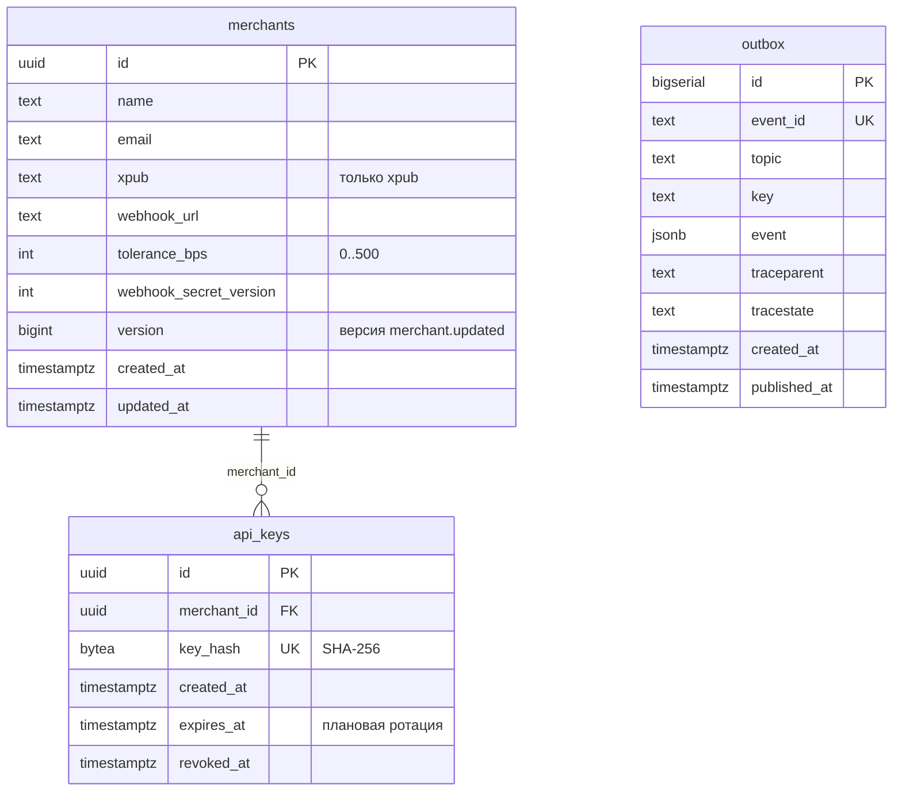
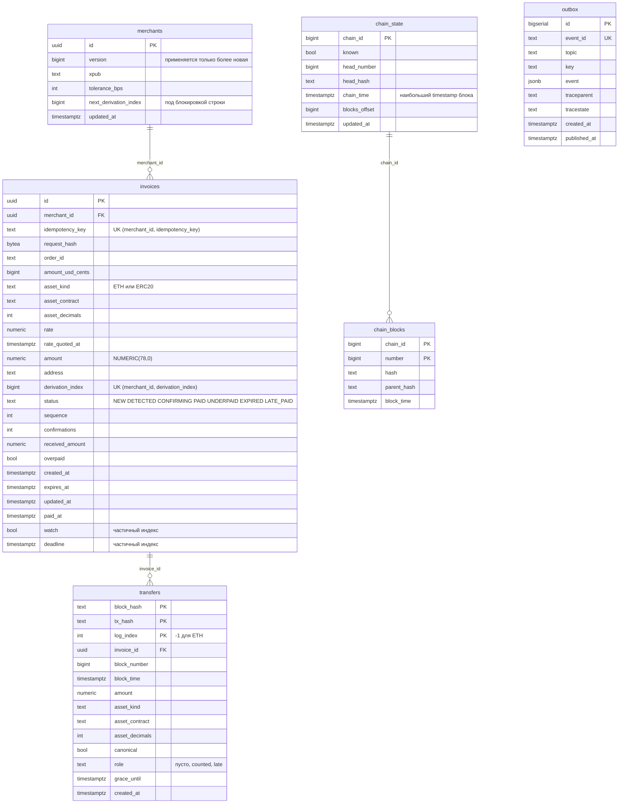
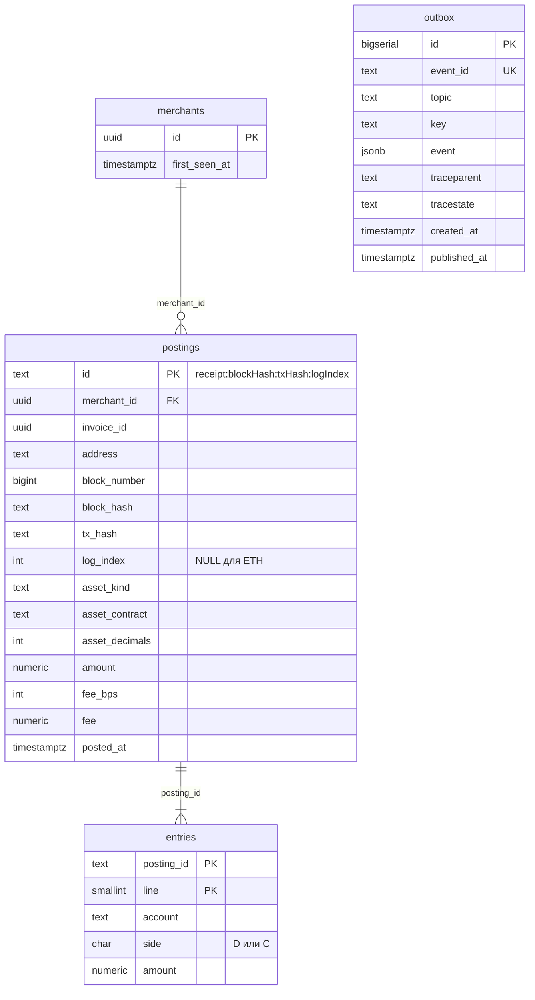

# ER-схема PostgreSQL

Схемы по миграциям `services/<service>/migrations/`. У каждого сервиса своя база, внешних ключей между базами нет:
связи между сервисами логические, через события Kafka. Суммы — `NUMERIC(78,0)`, USD — целые центы.
Таблица `outbox` одинакова в `invoice-service`, `merchant-service` и `ledger-service` (миграция `00001_outbox.sql`).

## merchant-service

Миграции `00001_outbox.sql`, `00002_merchants.sql`.

## invoice-service

Миграции `00001_outbox.sql`, `00002_invoices.sql`, `00003_lifecycle.sql`. `merchants` — проекция `merchant.events`.

Индексы `invoices`: `(merchant_id, idempotency_key)` и `(merchant_id, derivation_index)` уникальные, список мерчанта
`(merchant_id, created_at DESC, id DESC)`, поиск перевода `(address)`, `(id) WHERE watch`, `(deadline) WHERE deadline IS NOT NULL`.
`transfers`: `(invoice_id)`, `(block_number)`.

## ledger-service

Миграции `00001_outbox.sql`, `00002_ledger.sql`. Журнал только добавляется: триггеры запрещают `UPDATE`, `DELETE`
и `TRUNCATE`, отложенные триггеры проверяют, что у проводки не меньше двух строк и дебет равен кредиту.

Индексы: `postings (merchant_id, posted_at, id)`, `postings (address, posted_at, id)`, `entries (account)`.
`postings.invoice_id` внешнего ключа не имеет: счета живут в базе `invoice-service`.
