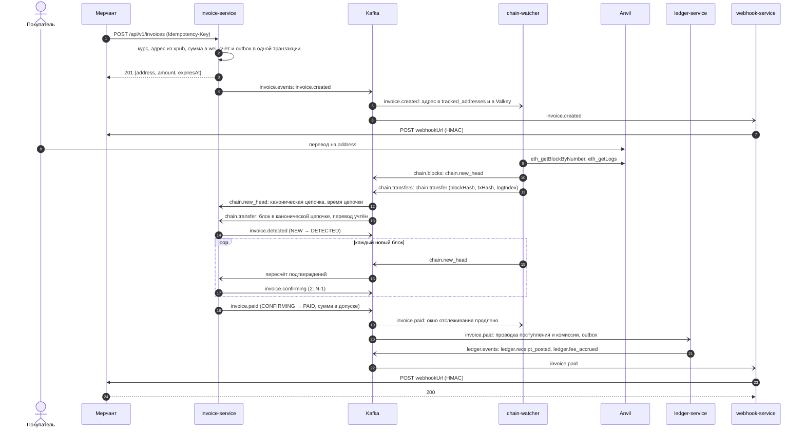
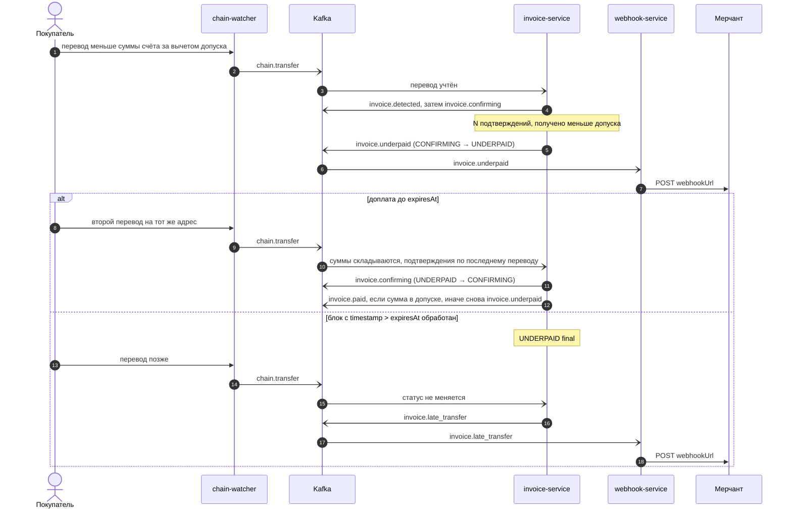
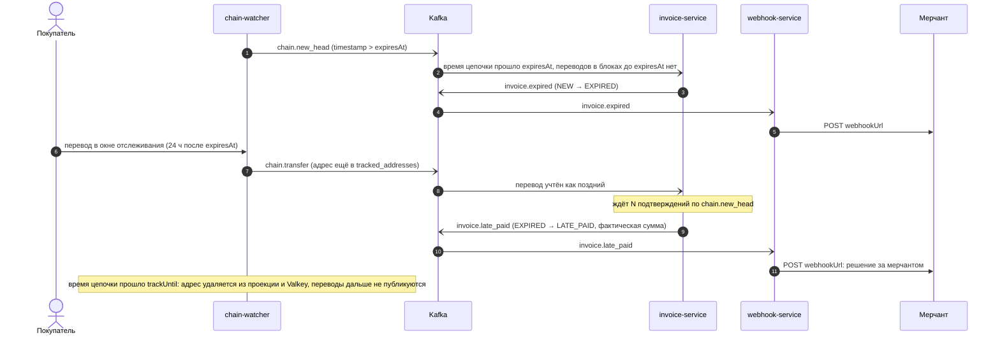
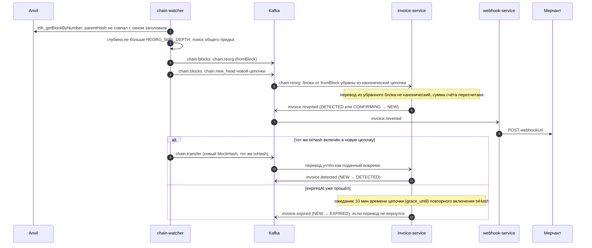
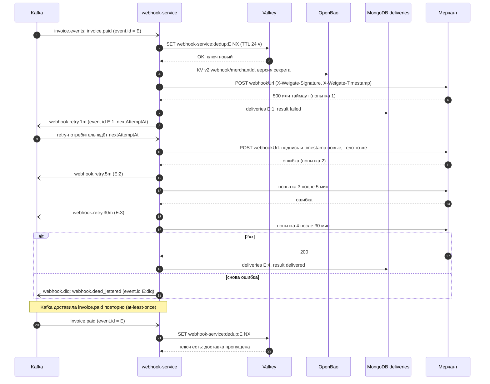

# Sequence-диаграммы

Сценарии SRS 9 по коду и контрактам. Топики и типы событий — в [`events.md`](events.md), статусы — SRS 4.1.4.
N — число подтверждений (`CONFIRMATIONS`, по умолчанию 7). Все сроки считаются по `timestamp` блоков (время цепочки).
Стрелка `-)` — асинхронное сообщение Kafka, `->>` — синхронный вызов.

## Успешная оплата

## Недоплата

## Истечение и поздний платёж

Переход в `LATE_PAID` окно не продлевает. Перевод на адрес счёта в финальном статусе внутри окна даёт `invoice.late_transfer`.

## Реорганизация

Проводка ledger создаётся только после N подтверждений, сторнирующих проводок нет (журнал только добавляется).

## Повторная доставка вебхука

Повтор из DLQ — `POST /internal/dlq/replay` на `ADMIN_ADDR`; запись «ушла из DLQ», когда в журнале есть доставленная
переотправка `<event.id>:dlq`.
